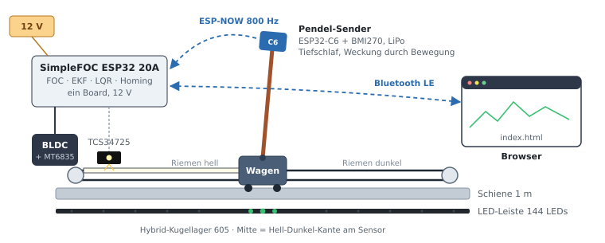

# Inverses Pendel auf Schiene

**Ein Wagen balanciert ein Pendel aufrecht – schwingt es selbst hoch, fängt es sanft auf und hält es über Minuten ruhig im instabilen Gleichgewicht.**

---

## Das Wichtigste in Kürze

| | |
|---|---|
| **Antrieb** | BLDC-Motor mit feldorientierter Regelung (FOC), Treiber, Strommessung und Regelung auf **einem Board** (SimpleFOC ESP32 20A) |
| **Pendel** | kabellos: eigener Sender an der Pendelspitze schickt die IMU-Daten per **ESP-NOW mit 800 Hz** |
| **Homing** | **ohne Anfahren der Endanschläge** – ein Lichtsensor erkennt eine Hell-Dunkel-Marke auf dem Riemen |
| **Mechanik** | nahezu spielfreie **Hybrid-Kugellager** (POM / Edelstahl, HSS3 605 TN) statt Gleitlager |
| **Versorgung** | nur **12 V** für den Wagen, das Pendel läuft auf einem kleinen LiPo-Akku mit Tiefschlaf |
| **Bedienung** | **aus dem Browser über Bluetooth** – eine einzige HTML-Datei, keine Installation, kein Treiber |

---

## Vorteile im Einzelnen

### Ein Board für alles
Motor-Endstufe (3 Halbbrücken), Strommessung (INA240) und ESP32 sitzen auf einer Platine. Der ESP32 regelt den Motorstrom mit ca. 14–20 kHz und rechnet daneben im festen 800-Hz-Takt Winkelschätzung und Balancierregler. Kein zweiter Controller, keine Kabel zwischen Rechner und Treiber.

### BLDC statt Schrittmotor oder DC-Getriebemotor
- kein Getriebe, kein Getriebespiel, keine Schrittauflösung
- 21-bit-Magnetencoder (MT6835) direkt auf der Motorwelle → Wagenposition auf Bruchteile eines Millimeters
- echte Stromregelung: Die Regelung gibt eine **Kraft** vor, nicht eine Drehzahl – genau das, was ein Balancierregler braucht
- Rastmoment-Kompensation: Der Motor lernt sein eigenes Rasten (Befehl `M`) und gleicht es im Betrieb aus

### Kabelloses Pendel
- Kein Schleppkabel, das am Pendel zieht oder es dämpft – das Pendel schwingt völlig frei
- ESP32-C6 + BMI270 (Beschleunigung + Drehrate) an der Pendelspitze, 800 Pakete/s per ESP-NOW (direkter Funk ohne Router)
- Die gesamte Sensorfusion läuft auf dem Wagen (erweitertes Kalman-Filter mit Latenzausgleich); der Sender bleibt einfach
- **Schlafmodus:** Hängt das Pendel 60 s still, geht der Sender in den Tiefschlaf. Der BMI270 wacht weiter über Bewegung – einmal anstoßen, und er ist sofort wieder da. Bei leerem Akku schützt ein eigener Tiefschlaf vor Tiefentladung.

### Homing ohne Anschläge
Ein Farb-/Lichtsensor (TCS34725) schaut auf die Rückseite des Riemens, deren eine Hälfte hell markiert ist. Die Grenze hell/dunkel liegt genau in der Schienenmitte.

- Nach dem Einschalten fährt der Wagen nur bis zur nächsten Kante – **kein Anschlagen an den Enden**, keine Belastung von Riemen und Mechanik
- Die Kante wird immer langsam und aus derselben Richtung angefahren → wiederholgenau
- Einmaliges Einlernen über die Anschläge (`F`) bestimmt Schwelle, Markierungsseite und Kantenlage automatisch
- Im Betrieb prüft die Firmware laufend, ob Marke und Encoder zusammenpassen (erkennt einen übersprungenen Riemenzahn)

### Leichtgängige, spielfreie Lagerung
Hybrid-Miniaturkugellager (POM-Ringe, Edelstahlkugeln, 605) führen den Wagen. Kaum Losbrechmoment, kein Spiel – die Regelung muss keine Haftreibung überwinden und der Wagen steht im Gleichgewicht praktisch still.

### Nur 12 V
Ein einziges 12-V-Netzteil versorgt Motor und Elektronik. Das Pendel braucht kein Kabel, sein Akku (LiPo) wird per USB geladen.

### Bedienung aus dem Browser
- Eine einzige Datei `index.html` – öffnen in Chrome oder Edge (Web Bluetooth), **Verbinden** drücken, fertig
- Live-Grafik von Wagen und Pendel, Verlauf von Position, Winkel, Beschleunigung und Strom, Log-Fenster
- Alle Funktionen per Knopf: Homing, Swing-up, Balancieren, Beruhigen, Soll-Mitte per Schieberegler
- 4-s-Rekorder mit 400 Hz als CSV zum Herunterladen, Diagnose- und Testfunktionen
- **Firmware-Update (OTA)** direkt aus der Web-App per WLAN – kein USB-Kabel nötig
- Funktioniert unter Windows, macOS, Linux, ChromeOS und Android (Chromium-Browser; Safari und Firefox unterstützen Web Bluetooth nicht)

---

## Was der Wagen kann

| Funktion | Beschreibung |
|---|---|
| **Swing-up** | Pumpt Energie ins hängende Pendel, bis es fast oben ist, und übergibt dann sanft an den Balancierregler – gefangen wird nur, wenn sich das Pendel auf die Senkrechte zubewegt |
| **Balancieren** | LQR-Zustandsregler auf Position, Geschwindigkeit, Winkel und Winkelrate; Gewichte live verstellbar |
| **Ruhezone** | Steht das Pendel senkrecht und der Wagen in der Mitte, hält der Wagen still – kein Zittern im Gleichgewicht |
| **Soll-Mitte** | Der balancierende Wagen fährt per Schieberegler ±350 mm mit weichem Geschwindigkeitsprofil an jede Stelle |
| **Beruhigen** | Entzieht dem schwingenden Pendel aktiv Energie, bis es in wenigen Sekunden ruhig hängt |
| **Selbstabgleich** | Balancierpunkt wird laufend nachgeführt und gespeichert; Pendellänge per Periodenmessung |
| **Sicherheit** | Softlimits vor den Enden, kontrolliertes Abbremsen, Abschalten bei Funkverlust oder Überschreiten der Endlage, STOPP per Leertaste |
| **LED-Leiste** | 144 LEDs entlang der Schiene zeigen Wagen und Modus (grün → rot mit dem Pendelwinkel, blau in Ruhe); im Stillstand gelegentlich ein Lauflicht in wechselnden Farben |

---

## Technische Daten

| | |
|---|---|
| Schiene | 1 m, Verfahrweg ca. 890 mm, GT2-Riemen, Riemenscheibe 20 Zähne |
| Motor | BE5208, 11 Polpaare, Encoder MT6835 (21 bit) |
| Treiber | SimpleFOC High-Power ESP32 20A, INA240-Strommessung |
| Pendel | 27 cm, Ersatzlänge 0,21 m |
| Pendel-Sender | ESP32-C6 Super Mini, BMI270, LiPo 150 mAh |
| Regeltakte | Stromregelung ca. 14–20 kHz, Regler 800 Hz, Funk 800 Hz |
| Versorgung | 12 V / 10 A (Wagen), Akku (Pendel) |
| Schnittstellen | Bluetooth LE (Bedienung), ESP-NOW (Pendel), WLAN (Firmware-Update), USB (seriell) |
| Software | Arduino / C++ (Wagen, Sender), HTML + JavaScript (Bedienung) |

---

## Ablauf in vier Schritten

1. **Einschalten** – 12 V an, der Wagen sucht die Riemenmarke und stellt sich in die Mitte.
2. **Verbinden** – `index.html` im Browser öffnen, *Verbinden* drücken.
3. **Swing-up** – der Wagen schwingt das Pendel hoch und fängt es auf.
4. **Zuschauen** – das Pendel balanciert; mit dem Schieberegler den Wagen verschieben, mit dem Finger anstupsen, *Beruhigen* zum Beenden.
